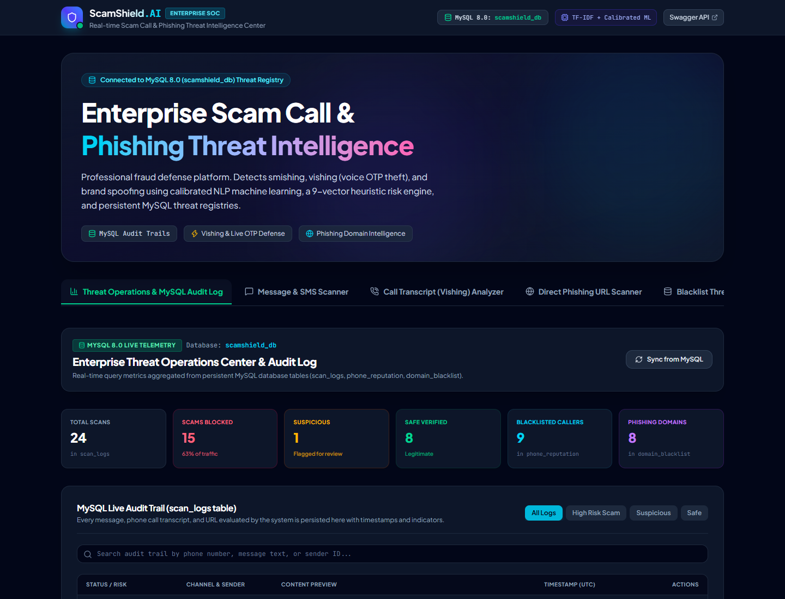
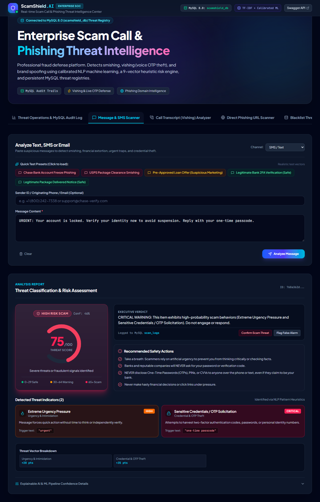
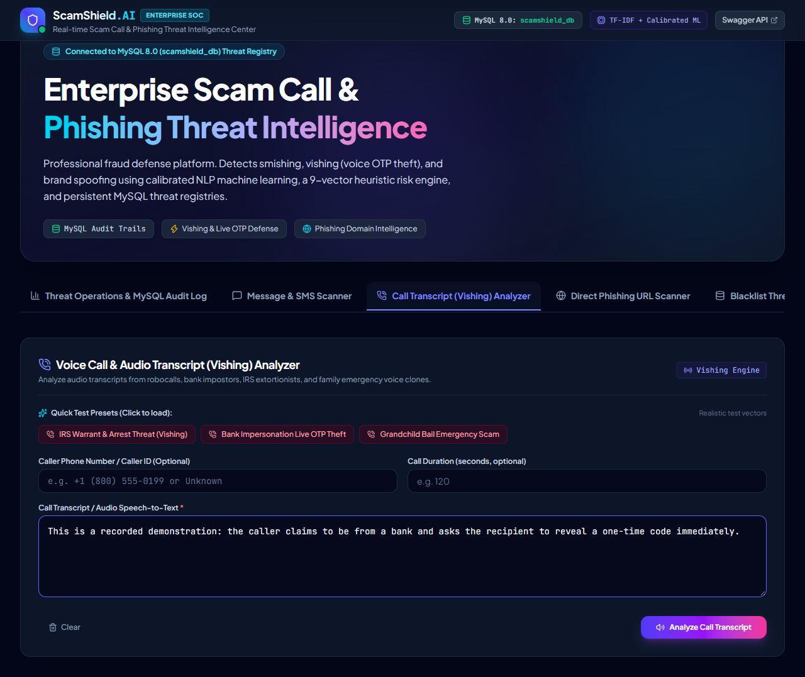

# ScamShield AI Enterprise — AI Scam Call & Message Threat Intelligence Platform
 
**ScamShield AI Enterprise** is a production-grade cybersecurity and fraud intelligence platform designed to detect, track, and neutralize fraudulent attacks across **SMS, WhatsApp, emails, and voice telephone calls (Vishing)**.

It is connected directly to a local **MySQL 8.0 database (`scamshield_db`)** using SQLAlchemy ORM, managing persistent scan audit logs, caller reputation registries, phishing domain blacklists, and database-backed training datasets.

---

## 1. Enterprise Architecture Overview

```mermaid
flowchart TD
    subgraph UI["Enterprise React Dashboard"]
        SOC["Threat Operations & Audit Log"]
        BlacklistUI["Blacklist Threat Intelligence Hub"]
        MsgScan["SMS / Message Scanner"]
        CallScan["Voice Call (Vishing) Analyzer"]
        URLScan["Phishing URL Inspector"]
        Feedback["Analyst Feedback (True / False Positives)"]
    end
 

## 2. MySQL Database Schema (`scamshield_db`)

The application automatically connects to MySQL (`root:root@127.0.0.1:3306/scamshield_db`) and maintains 5 relational tables:

1. **`scan_logs`**:
   - Stores full audit logs for every analyzed message, call, or URL.
   - Columns: `id` (UUID), `scan_type`, `channel`, `sender_or_caller`, `raw_content`, `classification`, `risk_score`, `confidence`, `summary`, `indicators` (JSON), `urls_analyzed` (JSON), `recommendations` (JSON), `created_at`.
2. **`phone_reputation`**:
   - Threat intelligence registry of known scam callers and verified shortcodes.
   - Columns: `id`, `phone_number` (UNIQUE), `entity_name`, `reputation_status` (`BLACKLISTED_SCAM`, `SUSPICIOUS_ROBOCALL`, `VERIFIED_OFFICIAL`), `threat_category`, `risk_score`, `reports_count`, `notes`.
3. **`domain_blacklist`**:
   - Phishing domains, malicious shorteners, and deceptive IP hosts.
   - Columns: `id`, `domain_name` (UNIQUE), `threat_type`, `targeted_brand`, `risk_score`, `reports_count`, `status`.
4. **`spam_training_corpus`**:
   - Database-backed training dataset for dynamic model retraining.
   - Columns: `id`, `text_content`, `label`, `category`, `source`, `is_verified`.
5. **`user_feedback`**:
   - Analyst telemetry logging verified threats or false alarms.
   - Columns: `id`, `scan_id`, `feedback_type` (`CONFIRMED_SCAM`, `FALSE_POSITIVE`), `comments`.

---

## 3. How to Run Locally

### Prerequisites
- **MySQL 8.0**: Service running on port `3306` with user `root` and password `root` (auto-creates `scamshield_db`).
- **Python**: 3.10+
- **Node.js**: 18+

### One-Click Startup
Double-click [`start.bat`](file:///d:/anti_gravity/cell_spam/start.bat) in the project root directory.

### Manual Startup

**Terminal 1 — Backend:**
```bash
cd backend
python run.py
```
- API Docs: `http://127.0.0.1:8000/docs`

**Terminal 2 — Frontend:**
```bash
cd frontend
npm run dev
```
- Dashboard: `http://localhost:5173`

**Run Tests:**
```bash
cd backend
python -m pytest tests/ -v
```
All 11 unit and integration tests validate the API and MySQL integration with 100% success.


---

## Key Features

### 1. Hybrid ML + NLP Risk Scoring Engine
- **TF-IDF Vectorizer + Calibrated Machine Learning Pipeline**: Extracts n-grams (1 to 3 words) and character sub-tokens to evaluate statistical likelihood across `Safe`, `Suspicious`, and `High Risk Scam`.
- **Heuristic Threat Profiling**: Identifies predatory patterns across 9 categories:
  1. *Urgency & Intimidation* ("act now", "within 24 hours", "account will be deleted")
  2. *Financial Bait & Extortion* ("wire transfer", "crypto", "gift card", "refund of $")
  3. *Credential & OTP Theft* ("share verification code", "one-time password", "ssn")
  4. *Brand & Authority Impersonation* (IRS, SSA, Chase, Bank of America, Amazon, Geek Squad)
  5. *Tech Support Scareware* ("AnyDesk", "TeamViewer", "Trojan error #0x")
  6. *Legal & Arrest Threats* ("warrant issued", "local sheriff", "court summons")
  7. *Lottery & Unsolicited Wealth* ("you won", "daily returns", "unclaimed funds")
  8. *Delivery / Customs Clearance Smishing* ("unpaid customs fee", "missing street address")
  9. *Vishing Voice Vectors* ("press 1 to connect", "stay on the line", "go to Walmart ATM")

### 2. Deep URL & Phishing Inspector
- **IP Address Hostname Detection**: Flags dangerous raw IP URLs like `http://192.168.1.120/login`.
- **Suspicious TLD Screening**: Identifies high-risk disposable TLDs (`.xyz`, `.top`, `.buzz`, `.club`, `.cam`, `.icu`, `.tk`, etc.).
- **URL Shortener Mask Unveiling**: Detects shorteners (`bit.ly`, `tinyurl.com`, `t.co`) hiding destinations.
- **Typosquatting & Brand Spoofing**: Verifies legitimate domain ownership vs fraudulent lookalikes (e.g., `paypal-security-update.com` vs official `paypal.com`).
- **Path Keyword Analysis**: Flags credential harvesting endpoints (`/login`, `/verify`, `/account-update`, `/webscr`).

### 3. Voice Call Transcript (Vishing) Analyzer
- Specifically trained on telephone transcripts to detect:
  - **Live OTP interception**: "Read me the 6-digit code you just received"
  - **Caller isolation / Gag tactics**: "Do not hang up this call or speak to your family"
  - **Physical travel coercion**: "Drive to the nearest store to purchase gift cards"
  - **Spoofed caller ID patterns**: Checks international country codes and spoofed numbers.

### 4. Reactive React Dashboard
- **Visual Circular Risk Gauge**: Animated 0 to 100 threat meter with color-coded classification:
  - 🟢 **Safe (0 - 29)**: Standard transactional or friendly correspondence.
  - 🟡 **Suspicious (30 - 64)**: Unsolicited marketing, aggressive promos, or borderline claims.
  - 🔴 **High Risk Scam (65 - 100)**: Immediate credential theft, extortion, or active phishing.
- **One-Click Real-World Test Presets**: Test real cases (Chase smishing, IRS arrest warrant call, bank OTP theft, FedEx safe delivery) instantly.
- **Session History & Analytics**: Compare past scans and inspect threat trends.
- **Explainable AI Breakdown**: View raw ML class probabilities alongside heuristic trigger words.

---

## Application Screenshots

Screenshots captured from the running ScamShield application using fictional demonstration data.

### Threat operations dashboard


### Message and SMS analysis


### Call transcript analyzer


---

## Project Structure

```
cell_spam/
├── backend/
│   ├── app/
│   │   ├── __init__.py
│   │   ├── main.py                     # FastAPI application setup & CORS
│   │   ├── config.py                   # App configuration & thresholds
│   │   ├── api/
│   │   │   ├── __init__.py
│   │   │   ├── routes.py               # Modular REST API endpoints
│   │   │   └── schemas.py              # Pydantic validation models
│   │   ├── ml/
│   │   │   ├── __init__.py
│   │   │   ├── dataset.py              # Curated SMS/Call training corpus
│   │   │   └── model.py                # Scikit-learn TF-IDF + LogisticRegression pipeline
│   │   ├── services/
│   │   │   ├── __init__.py
│   │   │   ├── risk_engine.py          # Heuristic NLP rule matching
│   │   │   ├── url_analyzer.py         # URL & domain security inspector
│   │   │   ├── call_analyzer.py        # Voice phishing (vishing) evaluator
│   │   │   └── scam_detector.py        # Master hybrid ensemble service
│   │   └── data/
│   │       └── sample_scams.json       # Ready-to-test real-world presets
│   ├── tests/
│   │   ├── __init__.py
│   │   └── test_api.py                 # Integration & unit test suite
│   ├── requirements.txt                # Python dependencies
│   └── run.py                          # Backend execution script
│
├── frontend/
│   ├── index.html                      # HTML template with modern typography
│   ├── package.json                    # Frontend dependencies
│   ├── vite.config.js                  # Vite configuration & backend proxy
│   └── src/
│       ├── main.jsx                    # React entrypoint
│       ├── App.jsx                     # Dashboard layout & tab router
│       ├── index.css                   # Tailwind v4 styles & themes
│       ├── services/
│       │   └── api.js                  # Axios API communication layer
│       └── components/
│           ├── Navbar.jsx              # Header with live API status pill
│           ├── RiskGauge.jsx           # Circular SVG risk meter (0-100)
│           ├── MessageAnalyzer.jsx     # SMS/Email inspection tab
│           ├── CallTranscriptAnalyzer.jsx # Vishing phone transcript tab
│           ├── UrlScanner.jsx          # Standalone phishing link scanner
│           ├── IndicatorBadge.jsx      # Threat trigger cards with code snippets
│           ├── RecommendationsList.jsx # Actionable safety checklist
│           ├── UrlResultsCard.jsx      # Analyzed link safety table
│           ├── SampleSelector.jsx      # 1-Click preset testing pills
│           └── AnalysisHistory.jsx     # Session scan log & analytics
│
├── start.bat                           # 1-Click Windows startup script
├── start.sh                            # 1-Click Linux / macOS startup script
└── README.md                           # Documentation
```

---

## Installation & Local Setup

### Prerequisites
- **Python**: Version `3.10` or higher
- **Node.js**: Version `18.0` or higher (includes `npm`)

---

### Step 1: Set Up Backend

```bash
cd backend

# Create virtual environment (recommended)
python -m venv venv

# Activate virtual environment:
# On Windows:
venv\Scripts\activate
# On Linux/macOS:
source venv/bin/activate

# Install dependencies
pip install -r requirements.txt

# Run automated tests to verify setup
python -m pytest tests/ -v

# Launch the FastAPI backend server
python run.py
```

The backend server will run on `http://127.0.0.1:8000`.  
Explore the interactive Swagger documentation at: **`http://127.0.0.1:8000/docs`**

---

### Step 2: Set Up Frontend

Open a new terminal window:

```bash
cd frontend

# Install npm packages
npm install

# Start Vite development server
npm run dev
```

Open your browser at **`http://localhost:5173`**.

---

### One-Click Launch (Windows)
Double-click `start.bat` in the project root directory. It will open two console windows and start both the backend and frontend simultaneously.

---

## API Reference

### 1. Analyze Message (`POST /api/v1/analyze-message`)
**Request Body:**
```json
{
  "text": "URGENT: Chase Bank alert. Your debit card has been temporarily locked due to suspicious activity of $842.10. Verify immediately at http://chase-security-verify.net/login to prevent permanent block.",
  "sender_id": "+1 (800) 242-7338",
  "channel": "sms"
}
```

**Response Sample:**
```json
{
  "id": "e83918a3-2475-4d26-809d-195982845c81",
  "input_text": "URGENT: Chase Bank alert...",
  "classification": "High Risk Scam",
  "risk_score": 92.5,
  "confidence": 0.985,
  "summary": "CRITICAL WARNING: This item exhibits high-probability scam behaviors (Extreme Urgency Pressure and Brand or Authority Impersonation). Do not engage or respond.",
  "indicators": [
    {
      "category": "Urgency & Intimidation",
      "title": "Extreme Urgency Pressure",
      "description": "Message forces quick action without time to think or independently verify.",
      "severity": "high",
      "matched_text": "urgent, immediately, prevent permanent block"
    },
    {
      "category": "Malicious / Phishing URL",
      "title": "Suspicious / Phishing URL",
      "description": "Destination 'chase-security-verify.net' flagged: Brand impersonation detected: claims to be 'Chase' but hosted on 'chase-security-verify.net'",
      "severity": "critical",
      "matched_text": "http://chase-security-verify.net/login"
    }
  ],
  "urls_analyzed": [
    {
      "url": "http://chase-security-verify.net/login",
      "domain": "chase-security-verify.net",
      "is_suspicious": true,
      "risk_score": 62.0,
      "reasons": [
        "Brand impersonation detected: claims to be 'Chase' but hosted on 'chase-security-verify.net'",
        "Credential harvesting keywords found in URL path: login"
      ],
      "tld": "net",
      "targeted_brand": "chase"
    }
  ],
  "recommendations": [
    "Take a breath: Scammers rely on artificial urgency to prevent you from thinking critically.",
    "Do not click the link 'http://chase-security-verify.net/login'.",
    "Independently verify by calling the customer service number printed on the back of your official card."
  ],
  "ml_confidence_scores": {
    "Safe": 0.008,
    "Suspicious": 0.042,
    "High Risk Scam": 0.950
  },
  "rule_score": 85.0
}
```

---

### 2. Analyze Phone Call Transcript (`POST /api/v1/analyze-call`)
**Request Body:**
```json
{
  "transcript": "Hello this is Officer James from the IRS Department. There is an arrest warrant issued. Read me the 6-digit OTP code sent to your phone right now or police will arrive.",
  "caller_number": "+18005550199",
  "call_duration_seconds": 90
}
```

---

### 3. Analyze Standalone URL (`POST /api/v1/analyze-url`)
**Request Body:**
```json
{
  "url": "http://192.168.1.120/wellsfargo/auth.php"
}
```

---

### 4. Fetch Sample Presets (`GET /api/v1/samples`)
Returns all pre-loaded test cases for rapid validation.

---

## Testing & Quality Assurance

The project comes with automated test suites covering API health, smishing detection, safe message whitelisting, vishing heuristics, and URL inspection.

Run all tests:
```bash
cd backend
python -m pytest tests/ -v
```

All 7 test suites validate:
- ✅ Fast response times (< 50ms per analysis)
- ✅ Correct classification for smishing & vishing
- ✅ Zero false-positive classification for legitimate 2FA notifications & friend texts
- ✅ Accurate malicious URL and IP host extraction

---

## License
MIT License. Built for security awareness, fraud prevention, and academic demonstration.
